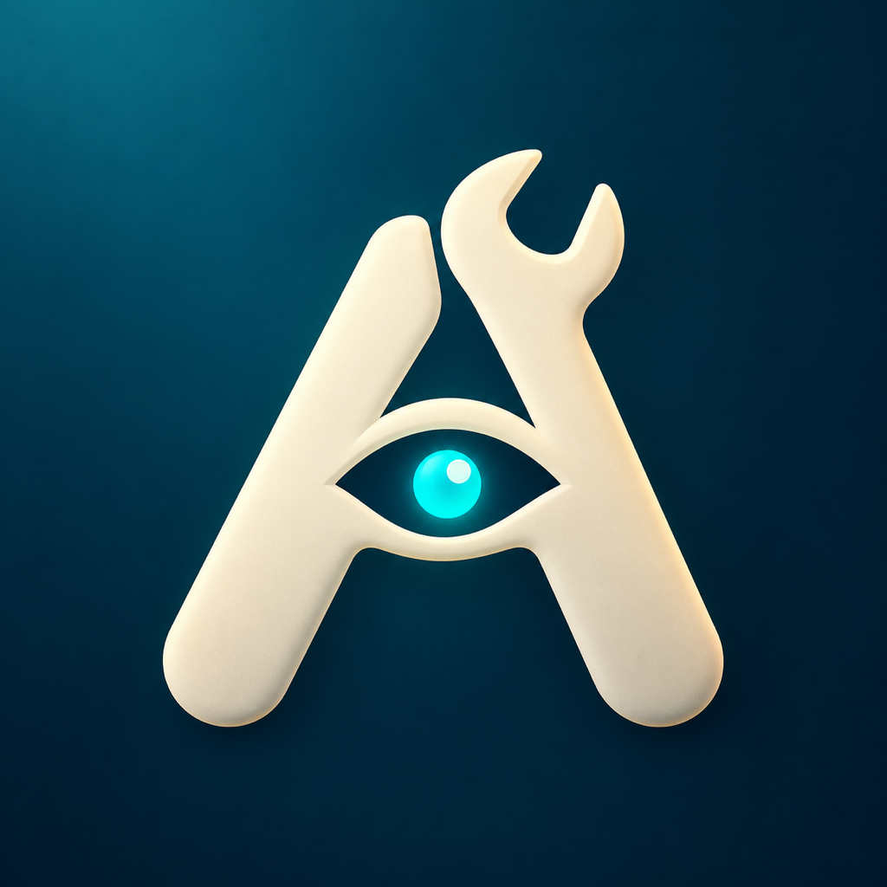
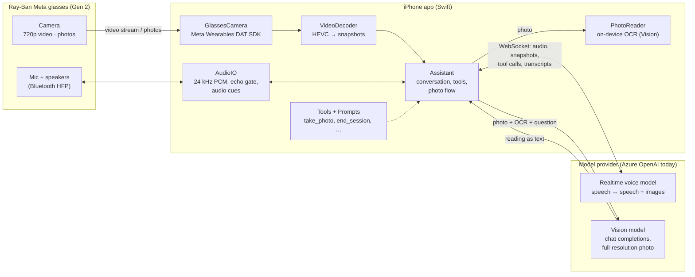

<p align="center">
  
</p>

<h1 align="center">Auzar.ai</h1>

<p align="center"><b>A hands-free AI helper that sees what you see and talks you through the job.</b><br>
Live video from smart glasses, a realtime voice model, and a vision model for the fine print.</p>

<p align="center"><i>🚧 Work in progress: an experimental prototype, tested by one person on real tasks. Expect rough edges.</i></p>

---

*Auzar* (औज़ार) is Hindi for **tools**.

## Why

If you're handy, you don't need the internet to tell you that a filter or a faucet cartridge
exists. You need someone looking over your shoulder who says: *that's the shutoff valve, turn
it clockwise. Now the nut on the left. No, the other one.* Videos and manuals can't see your
situation, and holding a phone in one hand while you work gets old fast.

Auzar puts that helper in a pair of camera glasses. You talk; the AI watches the live camera
feed, answers in your ear, and guides you step by step, with both hands free. This is
**ambient intelligence for DIYers and handy people**: real-time video streaming and analysis
that turns "I think I can fix this" into getting it done.

## Scenarios

These are the cases it's being designed for and tested on. Each one shapes what gets built.

| | Scenario | What the AI does |
|---|---|---|
| 🛠 **Now** | **Identify what's in front of you.** "What is this?" "What printer model is this?" | Answers from the live video. When it needs detail, it takes a photo itself. |
| 🛠 **Now** | **Read labels and model plates.** Washer and dryer plates, product labels, part numbers, bags of fasteners. | Takes a quick photo, or a 12 MP photo if you agree. On-device OCR and a high-detail vision model read the small print. |
| 💡 **Next** | **Guided repair and maintenance.** Replace a furnace filter, fix a leaky faucet, reset a tripped GFCI, assemble flat-pack furniture. | Walks through the steps, checks each one on video ("good, the valve is closed"), and warns before risky steps. |
| 💡 **Next** | **Your car.** Open the hood, find and check the oil dipstick. | Gives directions for your make and model ("the release lever is left of the steering wheel, near your knee"). |
| 🔭 **Later** | **Technicians and work orders.** A shop tech resealing a camshaft cover. | Documents the job by voice: photos, notes and torque values tied to the work order. |

More detail: [`docs/scenarios.md`](docs/scenarios.md). Ideas backlog: [`docs/ideas.md`](docs/ideas.md).

### What works today

- A live voice conversation through the glasses' speakers and mic, with replies in about 2 to 4 s.
- About 15 fps video from the glasses to the phone. The AI gets a snapshot every few seconds.
- The AI decides when it needs a photo and takes it with a function call:
  - a **quick photo** (1080×1440, about 2 s) by default
  - a **12 MP photo** (4032×3024, 15 to 70 s over the glasses' link) only after asking you
- A vision model reads the full-resolution photo, combined with on-device OCR. In testing it read a
  printer's model badge ("imageCLASS MF269dw") that the voice model couldn't see.
- Audio cues while a photo is taken: a spoken line, soft beeps, and a chime when the photo is done.
- Recovery when the glasses drop the camera mid-session, and logs plus saved photos for debugging.

**Not yet:** step-by-step procedures, looking up manuals, Android, and a backend for keys (see
[Status](#status-and-roadmap)).

## Architecture



**How a turn works**

1. **Listen.** Glasses mic → `AudioIO` → the realtime model over a WebSocket. The server detects
   when you stop talking. The mic is gated while the guide speaks, so it doesn't hear itself.
2. **Look.** `GlassesCamera` streams video through Meta's DAT SDK. The phone shows it at the
   full frame rate, and `Assistant` sends the model a snapshot every few seconds. Only the
   newest few images stay in the model's context.
3. **Act through tools.** The model controls the glasses through function tools. For example,
   it calls `take_photo` with `detail: "quick" | "full"`, and the app plays the audio cues and
   captures the photo.
4. **Read the fine print.** The realtime model shrinks images to about 512 px, so photos also go
   to `PhotoReader` (on-device OCR) and a separate **vision model** at full resolution. Their
   readings go back to the realtime model as text.
5. **Speak.** The realtime model's audio streams back to the glasses' speakers.

**Code map** (`ios/SBSI/Sources/`)

| File | Role |
|---|---|
| `Assistant.swift` | The core loop: session setup, event handling, snapshots, tool dispatch, the photo flow |
| `RealtimeClient.swift` | WebSocket to the realtime model |
| `VisionClient.swift` | Photo → vision model (chat completions) |
| `Prompts.swift` | The guide's instructions (behaviour, photo tiers, safety) |
| `Tools.swift` | Function-tool definitions the model can call |
| `GlassesCamera.swift` | DAT SDK session, video stream, quick and 12 MP photos |
| `VideoDecoder.swift` / `VideoPreview.swift` | Snapshots for the model / the full-rate preview |
| `AudioIO.swift` | Bluetooth audio in and out, echo gate, tones, pre-recorded cues |
| `PhotoReader.swift` | On-device OCR and barcodes (Apple Vision) |
| `AppConfig.swift` | Endpoint, key and model names, injected at build time |
| `Log.swift` / `SessionMedia.swift` | Logs and saved images per session (visible in the Files app) |

## Getting started

### You need

- **Ray-Ban Meta glasses (Gen 2)**, paired in the Meta AI app, with Meta AI **Developer Mode** on
  (needed by the [Meta Wearables Device Access Toolkit](https://github.com/facebook/meta-wearables-dat-ios)).
- An **iPhone** (iOS 17.2+) and a Mac with **Xcode** and [XcodeGen](https://github.com/yonaskolb/XcodeGen) (`brew install xcodegen`).
- An Apple developer account (the free Personal Team works).
- A model provider. The code targets **Azure OpenAI** (Microsoft Foundry) out of the box, with:
  - a **realtime** deployment (e.g. `gpt-realtime-mini`)
  - optionally, a **vision** chat-completions deployment (e.g. `gpt-5.4-mini`) for reading photos

Step-by-step guides: [Meta glasses setup](docs/setup/01-meta-wearables-setup.md) ·
[Azure setup](docs/setup/02-azure-setup.md).

### Build

```sh
git clone https://github.com/dhruvstar10/auzar.git && cd auzar
cp .env.example .env              # fill in endpoint, key, deployment names (never commit .env)
tools/gen_ios_secrets.sh <APPLE_TEAM_ID>   # writes ios/Config/Secrets.xcconfig (gitignored)
cd ios && xcodegen && open SBSI.xcodeproj  # pick your team, then Run on your iPhone
```

Optional checks from the Mac:

```sh
python3 -m venv .venv && .venv/bin/pip install websockets==13.1
.venv/bin/python tools/realtime_smoke_test.py   # image + question → spoken answer
python3 tools/vision_test.py photo.jpg          # desk-test the vision model on a photo
```

> ⚠️ **Security:** this prototype builds the API key into the app, so keep builds to your own
> devices. Before sharing builds, mint short-lived tokens from a backend instead.

## Make it yours: extending Auzar

The design keeps the pieces you'd most likely swap at clear seams.

### Use a different realtime voice model

The app speaks the OpenAI **Realtime API** protocol: `session.update`, `input_audio_buffer.*`,
`conversation.item.create`, `response.*` events over a WebSocket.

- **Another Azure deployment:** change `AZURE_OPENAI_REALTIME_DEPLOYMENT` in `.env`, then re-run
  `tools/gen_ios_secrets.sh`.
- **OpenAI directly, or any Realtime-compatible server:** change `realtimeURL` in
  `AppConfig.swift` (e.g. `wss://api.openai.com/v1/realtime?model=…`) and the auth header in
  `RealtimeClient.swift` (`api-key` → `Authorization: Bearer …`).
- **A different protocol** (e.g. Gemini Live, or your own speech-to-text → LLM → text-to-speech
  pipeline): write a client like `RealtimeClient` and adapt the event handling in
  `Assistant.handle(_:)`. The audio (24 kHz PCM16) and the images (JPEG) stay the same.
- **The voice and turn detection** are set in the `session.update` in `Assistant.swift`.

### Use a different vision model

`VisionClient.swift` sends one **chat-completions** request: system prompt, question, OCR text
and the photo as a base64 `image_url`. Any OpenAI-compatible endpoint works with small changes:

- **Another Azure model:** set `AZURE_OPENAI_VISION_DEPLOYMENT` (e.g. a bigger model for hard labels).
- **OpenAI, a local server (Ollama, LM Studio, vLLM) or another provider:** change the URL and
  auth header in `VisionClient.send`, and the `model` field.
- **Turn it off:** leave the vision deployment empty; photos then go only to the realtime model.
- **Try it first on the desk:** `tools/vision_test.py` makes the same request as the app, so you
  can compare models on saved photos before changing the app.

### Give the AI new abilities (tools)

The model controls the glasses and the app through function tools. To add one, such as
`look_up_manual`, `start_timer`, `log_note` or `set_reminder`:

1. Add a definition (name, description, JSON-schema parameters) to `Tools.definitions` in `Tools.swift`.
2. Handle it in `Assistant.handleToolCall(name:callID:arguments:)`. Do the work, then send a
   `function_call_output` with the result and ask for a response, as `take_photo` does.
3. Tell the model when to use it in `Prompts.swift`.

### Change how it behaves

`Prompts.swift` holds the guide's instructions: its tone, when to take photos, safety rules, and
how to treat OCR. This is the quickest place to tailor Auzar to a trade (plumbing, auto,
electrical) or to a style of help (terse expert vs. patient teacher).

### Use other glasses or cameras

Everything glasses-specific is in `GlassesCamera.swift` (video and photos) and `AudioIO.swift`
(Bluetooth audio). Another camera source only needs to supply video samples and still photos to
`Assistant`. For example, you could use the iPhone camera for testing without glasses.

## Status and roadmap

This is an active prototype, built and tested in short loops: field test → read logs → fix.
The running log of what was tried and learned is in [`docs/status.md`](docs/status.md), and the
key design decisions, with their reasons, are in [`docs/decisions.md`](docs/decisions.md).

**Next up**
- [ ] Step-by-step procedures, with the AI checking each step on video.
- [ ] Look up manuals and specs for the identified model.
- [ ] Proactive speech that's helpful, not chatty.
- [ ] A backend that issues short-lived tokens, so builds can be shared.
- [ ] Faster photo transfer, or graceful handling of slow links.

**Known limits**
- 12 MP photos take 15 to 70 s, depending on the Bluetooth/Wi-Fi link, and pause the video.
- The glasses' only camera is at the left front corner. Hold things in front of your left eye.
- Tiny text is at the edge of what the camera can resolve. Getting closer beats more pixels.

## Contributing and forks

Forks are welcome. That's the point of sharing this. If you build on it:

- **Start with [`AGENTS.md`](AGENTS.md).** It's the shared context file for humans and AI coding
  assistants (Claude Code, Codex, Copilot, Cursor): the architecture, the hard-won facts about the
  glasses SDK, and the working rules.
- **Never commit secrets.** `.env` and `ios/Config/Secrets.xcconfig` are gitignored for a reason.
- Issues and pull requests with findings from your own tests are especially useful: which tasks
  worked, which didn't, and logs.

## License

[Apache License 2.0](LICENSE). You're free to use, modify and redistribute it, including
commercially. Keep the license and notices, and state your changes.

## Disclaimer

Auzar is an independent hobby project. It isn't affiliated with or endorsed by Meta, Ray-Ban
(EssilorLuxottica), Microsoft or OpenAI. AI guidance can be wrong. Use your own judgment,
follow the manufacturer's instructions, and call a professional for gas, mains electrical,
structural or other dangerous work.
